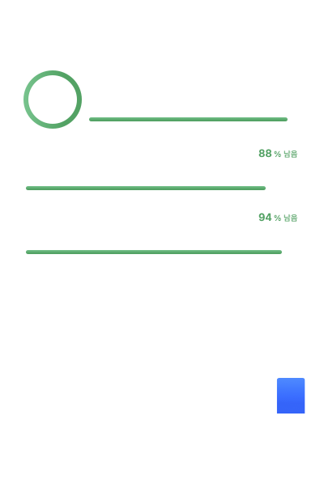

# Command Code Usage Bar

Command Code(GOAT 플랜) 사용량을 맥 상단바에서 실시간으로 확인하는 메뉴바 앱.



- **5시간 / 주간 / 월간 한도** — 남은량(used 대신 잔여 %), 상한, 초기화까지 남은 시간
- **오늘 관측된 사용량** — 크레딧 · 요청 수 · 입력/출력 토큰
- **최근 7일 추이** — 로컬에 누적한 일별 크레딧 사용량
- **macOS 26 Liquid Glass** — 실제 `glassEffect` API 로 만든 글래스 디자인 시스템

> 화면은 **사용량이 아니라 남은량**을 보여준다(메뉴바도 동일).
> 5시간 3.9/14 를 쓰면 `남음 10.1/14 · 72% 남음` 으로 표시한다.

---

## 설치

**macOS 26 이상** · Intel(x86_64) / Apple Silicon(arm64) 유니버설 바이너리

[Releases](https://github.com/jhparkdev/commandcode-usage-bar/releases)에서 `Command Code Usage Bar-<버전>-universal.dmg` 를 받아 Applications 폴더로 옮기고 실행합니다.

```bash
# 릴리스 다운로드 후 설치
curl -LO https://github.com/jhparkdev/commandcode-usage-bar/releases/latest/download/Command.Code.Usage.Bar-0.1.0-universal.dmg
hdiutil attach "Command.Code.Usage.Bar-0.1.0-universal.dmg"
cp -R "/Volumes/Command Code Usage Bar/Command Code Usage Bar.app" ~/Applications/
hdiutil detach "/Volumes/Command Code Usage Bar"
```

첫 실행 때 보안 경고가 뜨면 **우클릭 → 열기** 를 누릅니다(Developer ID 서명이 없는 빌드라
그렇게 해야 Gatekeeper 를 우회합니다). 그리고 Command Code 데스크톱 앱에 로그인되어 있어야
사용량을 조회할 수 있습니다.

<details>
<summary>소스에서 직접 빌드하기</summary>

```bash
# Intel/Apple Silicon 유니버설
./scripts/build-app.sh --universal

# 현재 아키텍처만
./scripts/build-app.sh --run
```
</details>

---

## 요구사항

| 항목 | 내용 |
|---|---|
| OS | macOS 26 이상 (Liquid Glass API 필수) |
| 툴체인 | Swift 6.x (Xcode 또는 Command Line Tools) |
| 계정 | Command Code 로그인 상태 (`~/.commandcode/auth.json`) |

## 빌드와 실행

```bash
# 앱 번들 빌드 + 실행
./scripts/build-app.sh --run

# ~/Applications 로 설치 + 로그인 시 자동 실행 등록
./scripts/install.sh

# Mac App Store 용(샌드박스) 빌드
./scripts/build-app.sh --sandbox
```

Xcode 프로젝트 없이 SwiftPM 으로 빌드하고 `Resources/Info.plist` 로 `.app` 번들을 직접
조립한다. `LSUIElement = true` 라서 Dock 아이콘은 뜨지 않고, 메뉴바에만 나타난다.

### 테스트

이 머신에는 Xcode 가 없어 XCTest / swift-testing 런타임을 쓸 수 없다. 대신 의존성 없는
자체 러너(`UsageCoreTestRunner`)로 테스트를 실행한다.

```bash
swift run UsageCoreTestRunner
```

커버 범위: API 응답 디코딩(숫자/문자열 tolerant), 엔드포인트 조합, 401 처리, 부분 실패
복원, 증가분 계산(첫 관측 baseline · 기간 변경 · 음수 보정), SQLite 누적과 권한(0600),
기간 범위 조회, 하루 1회 정리, 인증 파일 파싱, 표시 포매터.

### UI 스냅샷

팝오버를 실제 창에 올려 렌더링해 PNG 로 저장하는 개발용 옵션이다.

```bash
"dist/Command Code Usage Bar.app/Contents/MacOS/CommandCodeUsageBar" --snapshot /tmp/shot.png
```

---

## 디자인 시스템 (GlassUI)

`Sources/GlassUI/` 는 이 앱만 쓰는 liquid glass 디자인 시스템이다. 앱 화면은 이 모듈의
컴포넌트만 조립한다.

### 토큰

| 그룹 | 값 |
|---|---|
| 간격 스케일 | 1 · 2 · 4 · 6 · 8 · 12 · 16 · 20 · 24 · 32 (4px 기본, 1-4-9 리듬) |
| 모서리 | 컨트롤 10 · 카드 14 · 패널 18 · 히어로 22 · 캡슐 알약 |
| 타이포 | 3단계 위계 — 훅(히어로 30) / 브리지(제목 13) / 디테일(본문 12 · 캡션 10) |
| 모션 | 스프링 `response 0.34 / damping 0.82`, 스태거 25ms |

색상은 **역할**로만 정의한다. 상태(정상/주의/위험)는 의미를 담고, 강조는 시스템 액센트
색을 그대로 쓴다(액센트 남용 방지).

### 간격 규칙 (`GlassLayout`)

화면에서 숫자를 직접 쓰지 않는다. 간격은 “무엇 사이의 간격인가”로 이름을 붙인
역할(`GlassLayout`)로만 표현한다.

| 역할 | 값 | 쓰이는 곳 |
|---|---|---|
| `screenPadding` | 16 | 팝오버 바깥 여백 |
| `panelPadding` | 16 | 한도 보드(유리 패널) 안쪽 여백 |
| `sectionGap` | 20 | 최상위 섹션 사이(헤더 · 한도 · 관측 · 조작) |
| `subSectionGap` | 16 | 한 섹션 안 하위 섹션 사이(관측값 · 추이) |
| `groupGap` | 12 | 같은 그룹 안 형제 요소 사이 |
| `panelRowGap` | 12 | 한도 보드 안 한도 행 사이 |
| `statGap` | 16 | 통계 값 열 사이 |
| `labelGap` | 4 | 라벨 ↔ 값, 카드 내부 행 사이 |
| `valueGap` | 4 | 큰 값 ↔ 상한 |
| `inlineGap` | 2 | 인라인 아이콘 ↔ 텍스트 |
| `badgePadding*` | 8 / 4 | 배지 안쪽 여백 |
| `buttonPadding*` | 8 / 4 | 버튼 안쪽 여백 |
| `bannerPadding` | 12 | 배너 안쪽 여백 |
| `emptyStatePadding` | 24 | 빈 상태 여백 |

### 한도 보드의 해부

세 개의 한도(5시간 · 주간 · 월간)는 **하나의 유리 패널**에 모아 한 섹션으로 보여준다.
카드를 나란히 늘어놓으면 좁은 폭 때문에 제목이 잘리고, 서로 다른 섹션처럼 읽히므로
divider 로만 나눈다.

```text
╭──────────────────────────────────────────╮
│ (72% 남음)  5시간 한도                    │
│              10.1 / 14 크레딧      4시간 후 │
│              ▬▬▬▬▬▬▬▬▬▬▬▬▬▬▬▬▬▬▬░░░░░░░░░ │
│ ──────────────────────────────────────── │
│ 주간 한도                       89% 남음  │
│ 30.9 / 35                    6일 18시간 후 │
│ ▬▬▬▬▬▬▬▬▬▬▬▬▬▬▬▬▬▬▬▬▬▬▬▬▬▬▬▬▬▬▬▬▬▬▬▬ │
│ ──────────────────────────────────────── │
│ 월간 한도                       94% 남음  │
│ 65.9 / 70                       30일 남음 │
╰──────────────────────────────────────────╯
```

- 히어로는 원형 게이지가 퍼센트를 대신한다. 나머지 행은 헤더에 퍼센트를 둔다.
- 퍼센트에는 항상 단위(“남음”)를 붙인다. 색만으로 의미를 전달하지 않는다.

### 컴포넌트

| 컴포넌트 | 역할 |
|---|---|
| `GlassPanel` | 유리 표면 + 콘텐츠 (유리는 항상 배경 레이어) |
| `GlassLimitRow` / `GlassHeroLimit` | 한도 행 공통 해부(제목 · 값/상한 · 카운트다운 · 게이지 · %) |
| `GlassBadge` | 유리 알약 배지 (상태/범주) |
| `GlassIconButton` / `GlassTextButton` | 네이티브 `.glass` / `.glassProminent` 버튼 |
| `GlassMeter` / `GlassRing` | 선형 · 원형 사용률 게이지 |
| `GlassStat` / `GlassSectionLabel` / `GlassDivider` | 수치 · 섹션 라벨 · 구분선 |
| `GlassFormat` | 숫자·시간 표기(스레드 안전한 정적 포매터만 사용) |

### 글래스 사용 원칙

Apple의 지침을 그대로 따른다.

- 글래스는 **떠 있는 컨트롤 레이어**에만 쓴다. 모든 요소를 유리로 만들지 않는다.
- 유리는 콘텐츠의 **배경 레이어**로 둔다(콘텐츠가 유리 위로 가려지지 않게).
- `glassEffect` 는 레이아웃 모디파이어 **뒤에** 적용한다.
- 형태는 기능 안에서 통일한다(카드 18 · 히어로 22 · 컨트롤 알약).
- 상호작용 요소에만 `interactive` 를 쓴다.

> 참고: macOS 26 의 네이티브 `.glass` 버튼 스타일은 **화면 밖 렌더링에서 캡처되지
> 않는다.** 그래서 스냅샷 검증에는 `glassPreviewMode` 로 같은 유리 표면을 직접 얹은
> 대체 경로를 쓴다. 실제 앱에서는 네이티브 스타일이 그대로 쓰인다.

---

## 동작 방식

### 1. 인증

`~/.commandcode/auth.json` 의 `apiKey` 를 읽어 `Authorization: Bearer <key>` 로 요청한다.
키는 메모리에서만 쓰고 로그·DB·설정 파일에 남기지 않는다.

샌드박스 빌드(Mac App Store)에서는 이 파일을 직접 읽을 수 없다. 그래서 인증 방식을
세 가지로 나눴다(설정 › 인증).

| 방식 | 설명 |
|---|---|
| Command Code 인증 파일 | `~/.commandcode/auth.json` 직접 읽기(샌드박스 밖 기본값) |
| 사용자가 고른 파일 | `NSOpenPanel` 로 고른 파일을 보안 범위 북마크로 저장(샌드박스 대응) |
| API 키 직접 입력 | 키체인(`kSecClassGenericPassword`)에만 저장 |

### 2. 조회

Command Code 내부 API 를 그대로 사용한다.

| 용도 | 엔드포인트 |
|---|---|
| 계정 | `GET /alpha/whoami?limits=1` |
| 크레딧·사용 한도 | `GET /alpha/billing/credits?orgId=` |
| 구독 | `GET /alpha/billing/subscriptions?orgId=` |
| 기간 요약 | `GET /alpha/usage/summary?orgId=&since=<currentPeriodStart>` |

기준 구현(Command Code 설치본 내부):
`~/Library/Application Support/Command Code/app-state.json` 의 `accountCache` 에 같은 값이
캐시된다. 이 앱은 API 를 직접 호출하고, 실패했을 때만 이 캐시를 읽기 전용 폴백으로 쓴다.

### 3. 누적

서버는 현재 기간의 누적값만 준다. 그래서 스냅샷을 로컬 SQLite 에 저장하고 직전 관측과의
차이를 일별/시간별로 누적한다.

- 첫 관측(또는 결제 기간이 바뀐 직후)은 **baseline** 으로 잡고 증가분을 0 으로 둔다.
  그 이전에 쓰인 양은 알 수 없으므로 오늘 사용량에 섞지 않는다.
- 앱이 꺼져 있던 구간은 **재관측 시점의 증가분**으로 귀속된다.
- 기간 총 사용/잔액은 서버 값(권위)을, 그래프와 "오늘" 은 로컬 관측값을 쓴다.

DB 위치: `~/Library/Application Support/CommandCodeUsageBar/usage.sqlite` (권한 0600)

---

## 구조

```text
Sources/
  UsageCore/            UI 비의존 핵심
    Models/             UsageOverview, UsageSnapshot, UsageLimit, LimitSet, PlanCatalog
    Auth/               AuthConfiguration, AuthKeyResolver, KeychainStore
    Services/           CommandCodeAPIClient, UsageStore, UsageDeltaCalculator,
                        AuthKeyProvider, DesktopCacheReader
    Support/            AppSettings, CommandCodeVersion
  GlassUI/              Liquid Glass 디자인 시스템
    Components/         GlassPanel, GlassLimitRow, GlassBadge, GlassButtons,
                        GlassMeters, GlassStat
    GlassTokens(+GlassLayout), GlassPalette, GlassMotion, GlassFormat, GlassPreviewMode
  CommandCodeUsageBar/  메뉴바 앱
    Views/              MenuBarLabel, UsagePopoverView, LimitCards, TodayStats,
                        HistoryChart, SettingsView
    Services/           LaunchAtLogin, NotificationManager, SnapshotRenderer
    ViewModels/         UsageViewModel
  UsageCoreTestRunner/  자체 테스트 러너
Resources/
  Info.plist, PrivacyInfo.xcprivacy, AppIcon.icns
  Entitlements/         sandboxed.entitlements, developerid.entitlements
scripts/                build-app.sh, install.sh, release.sh, make-icon.swift
```

---

## 배포

### GitHub

```bash
swift run UsageCoreTestRunner     # 테스트
./scripts/build-app.sh            # 번들 빌드
./scripts/release.sh              # 서명·notarization·zip·dmg
```

`scripts/release.sh` 는 `SIGN_IDENTITY`(Developer ID)와 `NOTARY_PROFILE`
(`xcrun notarytool` 키체인 프로파일) 환경변수가 있으면 서명 → notarization → staple →
zip/dmg 까지 진행한다. GitHub Actions 워크플로(`.github/workflows/ci.yml`)가 빌드와
테스트를 자동 검증한다.

### Mac App Store

- 샌드박스 빌드: `./scripts/build-app.sh --sandbox` (샌드박스 + 네트워크 + 사용자 선택
  파일 읽기 엔티틀먼트).
- 샌드박스에서는 `~/.commandcode/auth.json` 직접 읽기가 불가능하므로, 설정에서
  **인증 파일 선택** 또는 **API 키 직접 입력**을 사용해야 한다.
- `PrivacyInfo.xcprivacy`(수집 데이터 없음, UserDefaults/FileTimestamp 사유)를 포함한다.
- 메뉴바 전용 앱이므로 `LSUIElement` 를 유지한다.

### 배포 준비도 (2026-10 기준)

| 대상 | 상태 | 남은 것 |
|---|---|---|
| 개인 사용 | ✅ 가능 | 지금은 `dist/` 빌드에서 실행 중. 설치하려면 `./scripts/install.sh` |
| GitHub 공개 | △ | 첫 커밋·원격 저장소·태그, Developer ID 서명(현재 유효 서명 인증서 0개), CI 러너를 `macos-26` 으로 지정(macOS 26 SDK 필요) |
| Mac App Store | ❌ | Xcode 설치(`actool`·`altool` 없음), Apple Developer Program 가입, App Store Connect 앱·Bundle ID 등록, Xcode 아카이브(.xcarchive) 생성, MAS용 asset catalog 아이콘 |

**직접 배포(Developer ID)** 가 현실적인 경로다. 서명 인증서와 Apple Developer 계정이
있으면 `scripts/release.sh` 로 서명 → notarization → staple → zip/dmg 까지 한 번에 된다.
인증서가 없으면 ad-hoc 서명 빌드가 만들어지며, 다른 Mac 에서 열 때 Gatekeeper 경고가
생긴다(우클릭 → 열기).

**Mac App Store 심사 리스크(가장 큰 항목)**: 이 앱은 Command Code 의 비공개 API 를 쓰고
인증 정보(Command Code 계정)가 있어야 동작한다. 심사자가 계정을 갖고 있지 않으면 앱이
로그인 안내만 보여 준다. 데모 계정 제공이나 사용 근거 설명이 필요할 수 있다.

---

## 개인정보

- API 키는 파일에 저장하지 않는다. ‘API 키 직접 입력’ 방식을 쓰더라도 키체인에만 저장한다.
- 사용량 수치만 로컬 DB 에 남긴다.
- 네트워크 요청은 설정된 API 주소(`https://api.commandcode.ai`)로만 나간다.
- 텔레메트리는 없다.

## 제약 사항

- **비공개 내부 API** (`/alpha/`). Command Code 앱이 업데이트되면 경로나 필드가 바뀔 수
  있다. 계약은 `CommandCodeAPIClient` 한 곳에 격리되어 있고, 응답이 안 읽히면 마지막
  스냅샷을 유지한 채 오류 상태를 표시한다.
- **푸시 없음.** 폴링만 가능하다(Command Code 앱 자체의 계정 캐시 TTL 도 60초다).
  기본 60초, 30/120/300초 선택 가능.
- **일별·모델별 서버 내역 없음.** 서버 `summary.models` 는 비어 있다.
- **앱이 꺼져 있으면 히스토리가 비어 있다.** 첫 관측은 baseline 이라 delta 가 0이다.
- **여러 Mac 동시 사용.** 서버 합계는 계정 전체 기준이지만 로컬 히스토리는 Mac 별이다.
